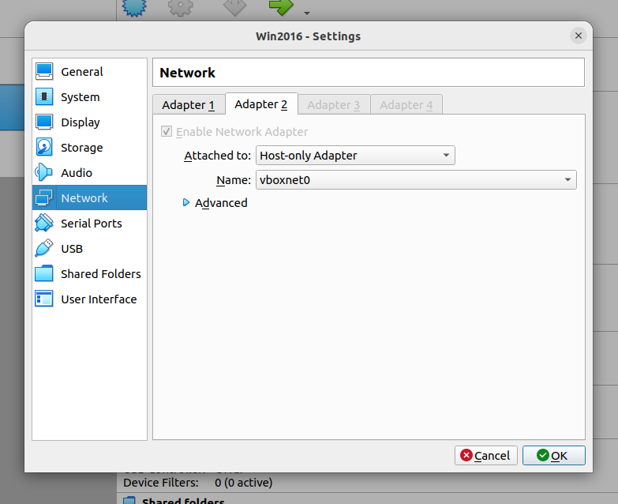

### 1. Install VM with windows server ###
### 2. Add Host-Only Adapter (as Adapter 2) ###



### 3. Set static IP for machine (run as admin powershell).  ###

Use whatever IP you want, this IP will be used for main OS to reach Virtual Machine (AD in our case).
```
New-NetIPAddress -InterfaceAlias "Ethernet 2" -IPAddress 192.168.56.101 -PrefixLength 24
```

Use that IP in midpoint config file **100-resource-ad**:

```
<gen735:host>192.168.56.101</gen735:host>
```

### 4. Get main OS IP ###

Run on guest (Ubuntu)
```
 ip addr show vboxnet0 
```

example of output:
```
6: vboxnet0: <BROADCAST,MULTICAST,UP,LOWER_UP> mtu 1500 qdisc fq_codel state UP group default qlen 1000
    link/ether 0a:00:27:00:00:00 brd ff:ff:ff:ff:ff:ff
    inet 192.168.56.1/24 brd 192.168.56.255 scope global vboxnet0
       valid_lft forever preferred_lft forever
    inet6 fe80::800:27ff:fe00:0/64 scope link 
       valid_lft forever preferred_lft forever
```

I this case `192.168.56.1` is IP of host. Should be configured in config.json as MIDPOINT_URL.

### 5. Start midpoint ###
Configure midpoint credentials and try to change user password.
Everything should be configured correctly, and after changing password midpoint should get notification.

### 6. Setup midpoint as HTTPS (optional) ###

Generate SSL certificate (make sure correct host IP is in -addext):
```
openssl req -x509 -newkey rsa:2048 -nodes \
  -keyout key.pem -out cert.pem -days 365 \
  -subj "/CN=localhost" \
  -addext "subjectAltName=DNS:localhost,IP:127.0.0.1,IP:192.168.56.1"
```

Create file nginx.conf:
```
server {
    listen 443 ssl;
    ssl_certificate     /etc/nginx/cert.pem;
    ssl_certificate_key /etc/nginx/key.pem;

    location / {
	    proxy_pass http://host.docker.internal:8080;
	    proxy_set_header Host $host;
	    proxy_set_header X-Forwarded-Proto https;
    }
}
```

Add nginx proxy to midpoint docker-compose:
```
  tls-proxy:
    image: nginx
    ports:
      - "8443:443"
    networks:
     - net
    volumes:
      - ./cert.pem:/etc/nginx/cert.pem:ro
      - ./key.pem:/etc/nginx/key.pem:ro
      - ./nginx.conf:/etc/nginx/conf.d/default.conf:ro
    depends_on:
      - midpoint-server
    extra_hosts:
      - "host.docker.internal:host-gateway"
```

Install cert on VM (otherwise requests will fail with Failed to establish SSL connection).
```
# run elevated
Import-Certificate -FilePath "C:\path\to\cert.pem" `
  -CertStoreLocation Cert:\LocalMachine\Root
```

MIDPOINT_PATH then should be `https://(IP):8443/midpoint`

If Windows Server 2025 installation gets stuck on Ubuntu, run this command before installation:
```VBoxManage modifyvm "Win2025" --hpet on```

### Windows Server 2025

In case midpoint (or ldapsearch) throws error:
```
LdapErr: DSID-0C09035C, comment: The server requires binds to turn on integrity checking if SSL\TLS are not already active on the connection, data 0, v65f4
```

We need to disable LDAP Signing Enforcement (usable only on virtual machines)

On your Windows Server 2025 VM, press `Win + R`, type `gpmc.msc` (Group Policy Management), and hit Enter.

In the left pane, navigate to: `Forest -> Domains -> [Your Domain] -> Domain Controllers`.

Right-click the `Default Domain Controllers Policy` and select Edit.

In the Group Policy Management Editor, navigate to:
`Computer Configuration -> Policies -> Windows Settings -> Security Settings -> Local Policies -> Security Options`

Look for the following two policies in the right pane and change them:

Domain controller: `LDAP server signing requirements enforcement` * Double-click it, check Define this policy setting, and set it to `Disabled`.

Domain controller: `LDAP server signing requirements` * Double-click it, check Define this policy setting, and set it to `None`.

Open Command Prompt as an Administrator on the server and run:

`gpupdate /force`